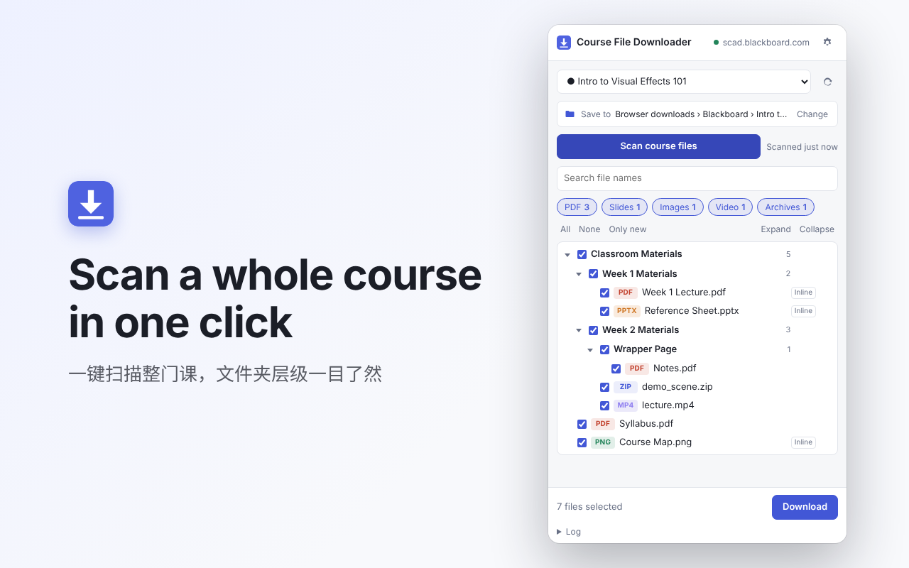
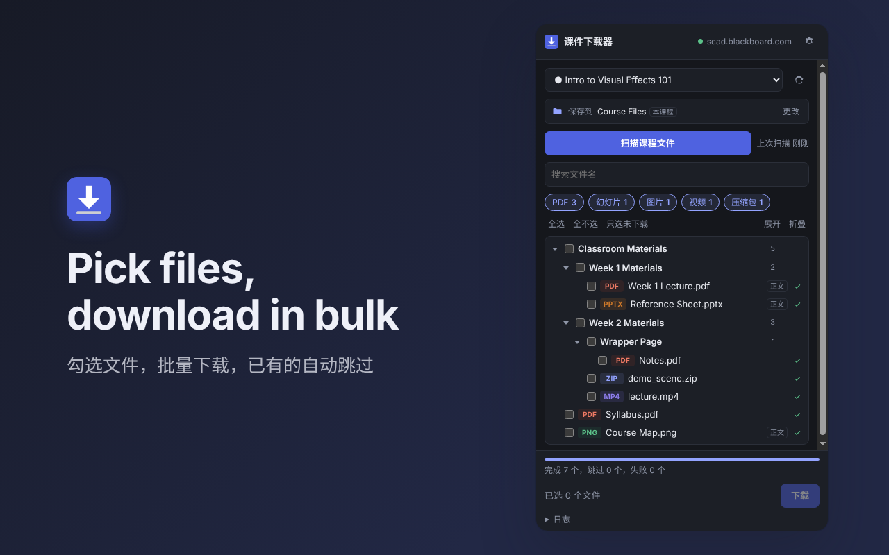
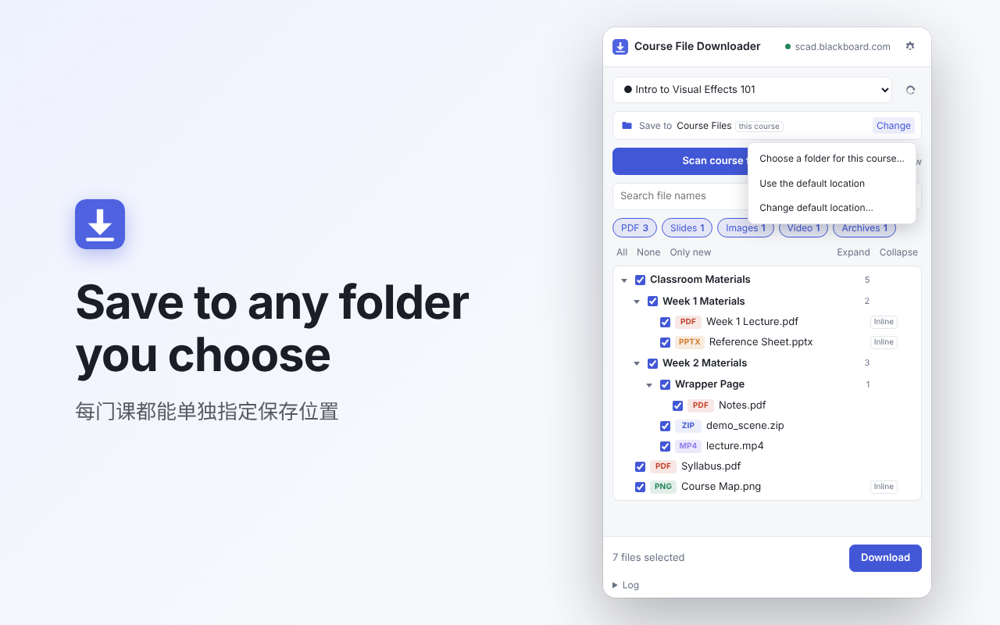
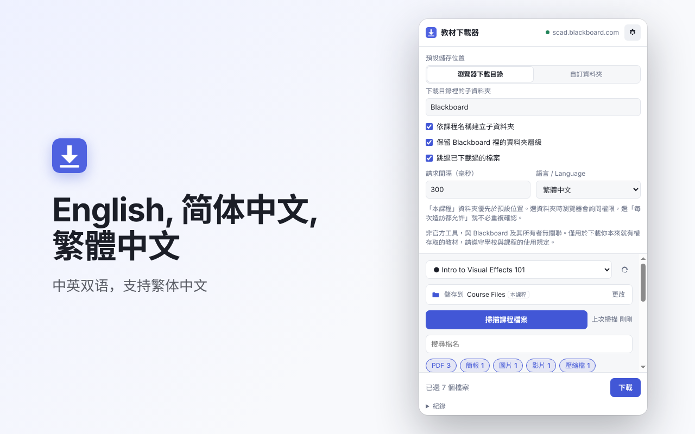

# Course File Downloader for Blackboard

**English** | [简体中文](README.zh-CN.md)

A Chrome and Edge extension that scans a Blackboard Ultra course and batch downloads the course files you already have access to, keeping the course's folder structure.

> **Unofficial.** This project is not affiliated with, endorsed by, or sponsored by Blackboard or its owner.

| Scan a course | Batch download |
|-|-|
|  |  |
| **Choose a folder** | **Three languages** |
|  |  |

## Features

- Scan a whole course in one click and see every file in a folder tree. It finds regular attachments and also file links that teachers placed inside page text (marked **Inline**).
- Filter by file type (PDF, slides, video, images and more) or search by name, then tick the files you want.
- Save to the browser's Downloads folder, or to any folder you choose. Each course can have its own folder.
- Remembers what you already downloaded and skips it, so a weekly update only fetches new files.
- Rescan a single folder instead of the whole course after a teacher adds new material.
- Interface in English, 简体中文 and 繁體中文.

## Install

The extension is not on the Chrome Web Store, so you install it from a zip file. It takes about two minutes.

1. Go to the [Releases page](../../releases/latest) and download the latest `blackboard-course-downloader-vX.Y.Z.zip`. Unzip it to a place you won't move or delete later, for example `D:\Tools\blackboard-course-downloader`. The browser loads the extension from this folder every time it starts.
2. In Chrome open `chrome://extensions` (in Edge open `edge://extensions`), and turn on **Developer mode**.
3. Click **Load unpacked** and choose the unzipped folder. You should see `manifest.json` directly inside the folder you pick.
4. Click the puzzle piece icon in the toolbar and pin **Course File Downloader for Blackboard** so the icon is always visible.

Good to know:

- When Chrome starts it may show a message like "Disable developer mode extensions". Just close it, the extension keeps working.
- Computers managed by a school or company may block Developer mode. In that case you can't install it on that computer.

### Update

1. Download the new zip from the Releases page and unzip it over the old folder, replacing the files.
2. Open `chrome://extensions` (or `edge://extensions`) and click the refresh arrow on the extension's card.
3. Close the side panel and open it again.

Your settings and download history are kept.

## How to use

1. Open Blackboard in the browser, sign in, and go to the course you want.
2. Click the extension icon. A side panel opens and selects the current course (it has a ● before the name).
3. Check the **Save to** line, then click **Scan course files**.
4. Use the type buttons and the search box to filter, tick the files, and click **Download**.

Scan results are cached. Next time, files you already downloaded show a green ✓, and only new files are ticked. When a teacher updates a folder, hover over it and click **Rescan** to refresh just that folder.

You can keep browsing other pages while it scans or downloads, but don't close the Blackboard tab or the side panel.

## Where files are saved

Each course can have its own folder. The order of priority is:

1. **Course folder.** On the **Save to** line click **Change → Choose a folder for this course…** and pick any folder, for example `D:\Courses\Blackboard\Intro to Design`. Files for this course go straight into it. To undo, use **Change → Use the default location**.
2. **Default location** (in Settings, the gear icon):
   - **Browser downloads**: saves into a subfolder of your browser's Downloads folder (named `Blackboard` by default).
   - **Custom folder**: pick one main folder, for example `D:\Courses\Blackboard`, and each course gets its own subfolder automatically.

The first time you pick a folder, the browser asks whether the extension may edit files in it. Choose **Allow on every visit** so it won't ask again. If it later says folder access needs confirming, you'll be asked once more when you click **Download**.

The browser does not allow picking the root of a drive (like `D:\`) or system folders. Pick any folder inside it instead.

Other settings:

- **Create a subfolder per course**: only applies to the default location.
- **Keep Blackboard's folder structure**: turn it off to put every file in one folder (files with the same name will overwrite each other).
- **Skip files already downloaded**: in custom folder mode it checks whether the file is already in the folder, in browser downloads mode it checks the browser's download history.
- **Delay between requests**: 300 ms by default. Please don't set it too low, so you don't put load on your school's Blackboard.

## Supported

- Blackboard **Ultra**, with your school's site under `*.blackboard.com` (for example `yourschool.blackboard.com`).
- Chrome or Edge, version 114 or newer.
- Not supported: Firefox, Safari, and schools that use their own custom domain for Blackboard.

## Troubleshooting

| What you see | What to do |
|-|-|
| "Not connected" | No Blackboard page is open in this browser. Click **Open Blackboard** and sign in. |
| "Sign-in needed" or "session has expired" | Go back to the Blackboard tab, refresh, sign in again, then scan or download again. |
| Red ✕ with "403" | The link is an external site or a publisher's reader, not a file stored in Blackboard. Download it by hand. |
| Yellow ! | The extension got a web page instead of the file, usually because the sign-in expired. Sign in again and retry. |
| A small window pops up when choosing a folder | The side panel sometimes can't open the folder picker itself. Choose the folder in that small window. |
| Can't pick a folder like `D:\` | Drive roots and system folders are not allowed by the browser. Choose a folder inside it. |

If something else goes wrong, please [open an issue](../../issues) and describe what you did and what you saw. Please don't include your school account, course names or file links.

## Privacy

The extension sends nothing to the developer or any third party, has no analytics, and never reads or stores your password or cookies. It only talks to your Blackboard site and Blackboard's own file servers. See [PRIVACY.md](PRIVACY.md) for details.

## Use responsibly

- Only download files you already have access to.
- Follow your school's and your course's rules.
- Course materials are usually copyrighted. Keeping them for your own study is one thing, please don't share them publicly.
- This tool is provided as is. The author is not responsible for how it is used or for any consequences of using it.

## Contributing

Issues and pull requests are welcome. The extension is plain JavaScript with no build step, everything is in the [`extension/`](extension) folder.

| File | Purpose |
|-|-|
| `manifest.json`, `_locales/` | Config, permissions, and the extension name and description in three languages |
| `background.js` | Opens the side panel when you click the icon, or a new tab if the side panel isn't supported |
| `panel.html` / `panel.css` / `panel.js` | The interface, save locations and the download flow |
| `bb.js` | Blackboard API requests, walking the course tree, finding file links in page text |
| `i18n.js` | Interface text in `zh` (Simplified), `zht` (Traditional) and `en`. The three sets of keys must stay identical, so add new text to all three. |
| `idb.js` | Stores the chosen folder handles in IndexedDB |
| `pick.html` / `pick.js` | The fallback window for choosing a folder |

There are no automated tests yet. Before opening a pull request, please go through this checklist by hand:

1. Load the `extension/` folder in `chrome://extensions` with no errors.
2. Sign in to Blackboard, open a course, click the icon. The side panel selects that course.
3. Scan. The file tree and type filters look right, and files marked **Inline** are there too.
4. Browser downloads mode: download a few files. The folder structure is right, and downloading again shows them as already there and skips them.
5. Custom folder mode: pick a folder and download. Files land in it. After restarting the browser, downloading asks for access again.
6. Switch between the three languages. The interface and the footer text all change.
7. Sign out of Blackboard and scan again. It should say the session has expired instead of hanging.

To publish a new version, bump `version` in `extension/manifest.json`, merge to `main`, then push a tag like `v1.3.1`. A GitHub Actions workflow builds the zip and creates the release.

## License

[MIT](LICENSE)
