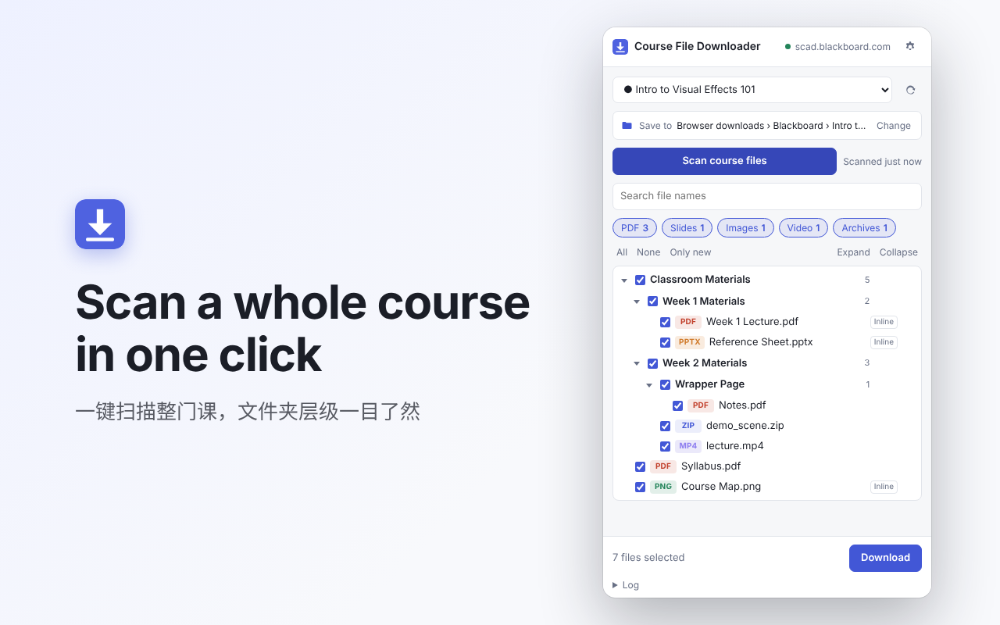
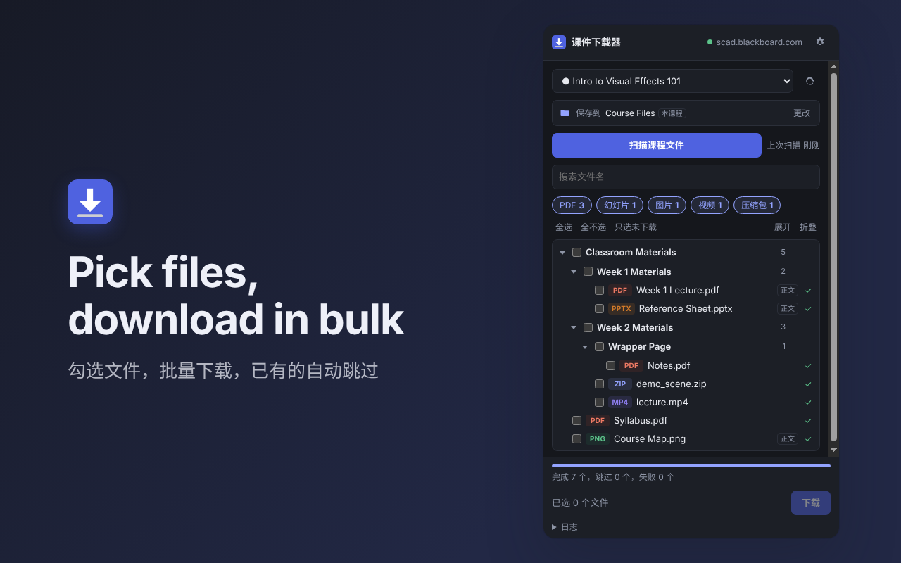
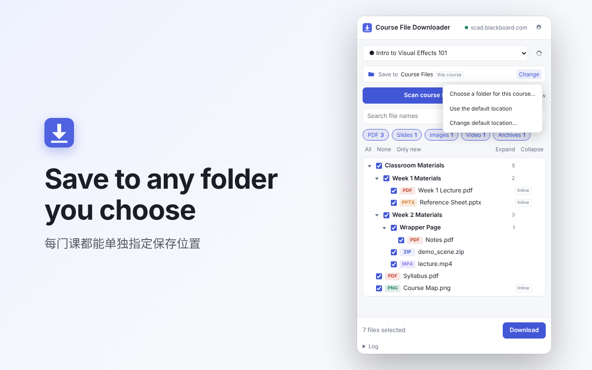
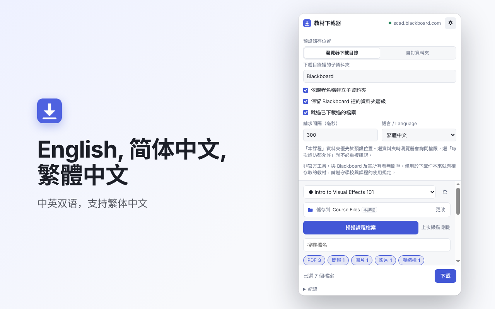

# Blackboard 课件下载器（非官方）

[English](README.md) | **简体中文**

一个 Chrome 和 Edge 扩展，扫描 Blackboard Ultra 课程，批量下载你本来就有权访问的课件，并保留课程里的文件夹结构。

> **非官方工具**，与 Blackboard 及其所有者没有任何关联，也没有得到其认可或赞助。

| 扫描课程 | 批量下载 |
|-|-|
|  |  |
| **选择文件夹** | **三种语言** |
|  |  |

## 功能

- 一键扫描整门课，所有文件按文件夹树显示。普通附件能找到，老师贴在页面正文里的文件链接也能找到（标为 **正文**）。
- 按类型筛选（PDF、幻灯片、视频、图片等）或按文件名搜索，勾选想要的文件。
- 保存到浏览器下载目录，或者任意你选的文件夹，每门课可以单独指定文件夹。
- 记住已经下载过的文件并跳过，每周更新时只下新文件。
- 老师更新课件后，可以只重扫某一个文件夹，不用重扫整门课。
- 界面支持简体中文、繁體中文和 English。

## 安装

扩展没有上架 Chrome 应用商店，需要从 zip 文件安装，大概两分钟。

1. 打开 [Releases 页面](../../releases/latest)，下载最新的 `blackboard-course-downloader-vX.Y.Z.zip`，解压到一个以后不会移动或删除的位置，比如 `D:\Tools\blackboard-course-downloader`。浏览器每次启动都会从这个文件夹加载扩展。
2. Chrome 打开 `chrome://extensions`（Edge 打开 `edge://extensions`），打开右上角的 **开发者模式**。
3. 点 **加载已解压的扩展程序**，选中解压出来的文件夹。选中的文件夹里应该直接能看到 `manifest.json`。
4. 点工具栏上的拼图图标，把 **Blackboard 课件下载器** 固定出来，方便以后点击。

注意：

- Chrome 启动时可能弹出 “停用开发者模式扩展” 之类的提示，点关闭就行，扩展照常能用。
- 学校或公司统一管理的电脑可能禁止开发者模式，这种电脑上没法安装。

### 更新

1. 从 Releases 页面下载新的 zip，解压后覆盖旧文件夹里的文件。
2. 打开 `chrome://extensions`（或 `edge://extensions`），点这个扩展卡片上的刷新箭头。
3. 关掉侧边栏再重新打开。

设置和下载记录都会保留。

## 使用方法

1. 在浏览器里打开 Blackboard 并登录，进到想下载的课。
2. 点工具栏上的扩展图标，侧边栏会自动选中当前课程（课程名前有 ●）。
3. 确认 **保存到** 那一行的位置，点 **扫描课程文件**。
4. 用类型按钮和搜索框筛选，勾选文件，点 **下载**。

扫描结果会缓存。下次打开时，已下载的文件显示绿色 ✓，默认只勾选新文件。老师更新了某个文件夹后，鼠标移到那个文件夹上点 **重扫**，只刷新这一个文件夹。

扫描和下载的时候可以去浏览别的网页，但不要关掉 Blackboard 标签页和侧边栏。

## 保存位置

每门课都可以单独指定文件夹，优先级如下：

1. **本课程文件夹**：点 “保存到” 那一行的 **更改 → 为这门课选择文件夹…**，选任意文件夹，比如 `D:\Courses\Blackboard\设计导论`。这门课的文件会直接存进去，不会再多套一层课程名文件夹。想改回去，点 **更改 → 改用默认位置**。
2. **默认位置**（在齿轮设置里）：
   - **浏览器下载目录**：存到浏览器下载位置下的子文件夹（默认叫 `Blackboard`）。
   - **自定义文件夹**：选一个总文件夹，比如 `D:\Courses\Blackboard`，每门课会自动建一个子文件夹。

第一次选文件夹时，浏览器会问是否允许扩展修改这个文件夹里的文件，选 **每次访问时都允许**，以后就不用重复确认。如果之后提示需要重新授权，点下载时会再弹一次确认，同意即可。

浏览器不允许选整个盘的根目录（比如 `D:\`）或系统文件夹，选它下面的任意子文件夹就行。

其他设置：

- **按课程名建子文件夹**：只对默认位置生效。
- **保留 Blackboard 里的文件夹层级**：关掉后所有文件放在同一个文件夹里，同名文件会互相覆盖。
- **跳过已下载过的文件**：自定义文件夹模式下直接检查文件夹里有没有这个文件，浏览器下载目录模式下看浏览器的下载记录。
- **请求间隔**：默认 300 毫秒，请不要调得太低，免得给学校的 Blackboard 造成压力。

## 适用范围

- Blackboard **Ultra**，学校网址在 `*.blackboard.com` 下（比如 `yourschool.blackboard.com`）。
- Chrome 或 Edge，114 及以上版本。
- 不支持：Firefox、Safari，以及 Blackboard 使用学校自定义域名的情况。

## 常见问题

| 现象 | 处理方法 |
|-|-|
| 显示 “未连接” | 浏览器里没有打开 Blackboard 页面，点 **打开 Blackboard** 并登录。 |
| 显示 “需要登录” 或 “登录已过期” | 回到 Blackboard 标签页刷新，重新登录，再扫描或下载。 |
| 文件显示红色 ✕，提示 403 | 这是外部链接或出版社阅读器，不是存在 Blackboard 里的文件，只能手动处理。 |
| 文件显示黄色 ! | 下载到的是网页而不是文件，一般是登录过期，重新登录后再下。 |
| 选文件夹时弹出一个小窗口 | 侧边栏里有时没法直接打开选择框，在小窗里选就行。 |
| 选不了 `D:\` 这样的位置 | 浏览器不允许选盘符根目录和系统文件夹，选它下面的文件夹。 |

遇到其他问题，欢迎 [提一个 issue](../../issues)，写清楚你做了什么、看到了什么。请不要贴学校账号、课程名或文件链接。

## 隐私

扩展不会向开发者或任何第三方发送数据，没有任何统计分析，也不会读取或保存你的密码和 cookie。它只会访问你的 Blackboard 站点和 Blackboard 自己的文件服务器。详见 [PRIVACY.md](PRIVACY.md)。

## 合规使用

- 只下载你本来就有权访问的文件。
- 遵守学校和课程的规定。
- 课件通常受版权保护，自己存档学习可以，请不要公开分享。
- 本工具按现状提供，作者不对使用方式和使用后果负责。

## 参与维护

欢迎提 issue 和 pull request。扩展是纯 JavaScript，不需要构建，代码都在 [`extension/`](extension) 文件夹里。

| 文件 | 作用 |
|-|-|
| `manifest.json`、`_locales/` | 配置、权限，以及三种语言的扩展名称和描述 |
| `background.js` | 点图标时打开侧边栏，不支持侧边栏时改用新标签页 |
| `panel.html` / `panel.css` / `panel.js` | 界面、保存位置和下载流程 |
| `bb.js` | Blackboard API 请求、遍历课程目录、解析正文里的文件链接 |
| `i18n.js` | 界面文案，分 `zh`（简体）、`zht`（繁体）、`en` 三份，三份的键必须完全一致，新增文案要三份一起加 |
| `idb.js` | 用 IndexedDB 保存所选文件夹的授权 |
| `pick.html` / `pick.js` | 选文件夹的备用小窗 |

目前还没有自动化测试。提 pull request 前，请手动过一遍下面的清单：

1. 在 `chrome://extensions` 加载 `extension/` 文件夹，没有报错。
2. 登录 Blackboard，打开一门课，点图标，侧边栏自动选中这门课。
3. 扫描后文件树和类型筛选正确，标为 **正文** 的文件也在。
4. 浏览器下载目录模式：下载几个文件，目录结构正确，再次下载会显示已存在并跳过。
5. 自定义文件夹模式：选一个文件夹并下载，文件落在里面；重启浏览器后再下载，会提示重新授权。
6. 切换三种语言，界面和底部文字都跟着变。
7. 退出 Blackboard 登录后再扫描，应该提示登录已过期，而不是卡住。

发布新版本：修改 `extension/manifest.json` 里的 `version`，合并到 `main`，然后推送一个 `v1.3.1` 这样的标签，GitHub Actions 会自动打包并创建 Release。

## 协议

[MIT](LICENSE)
